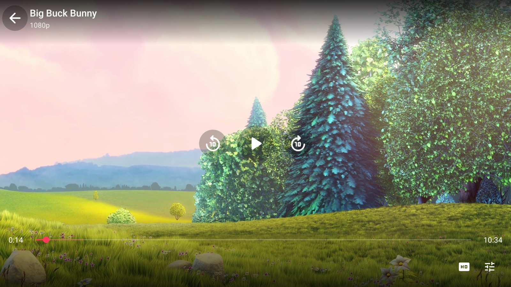
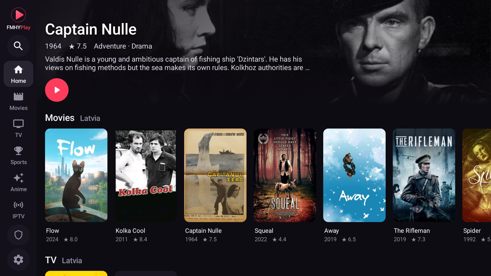
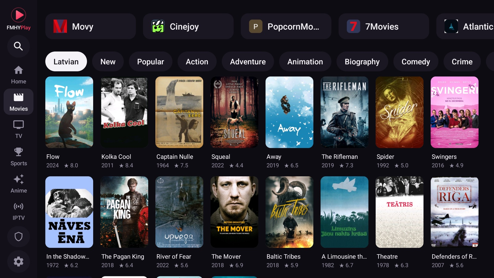
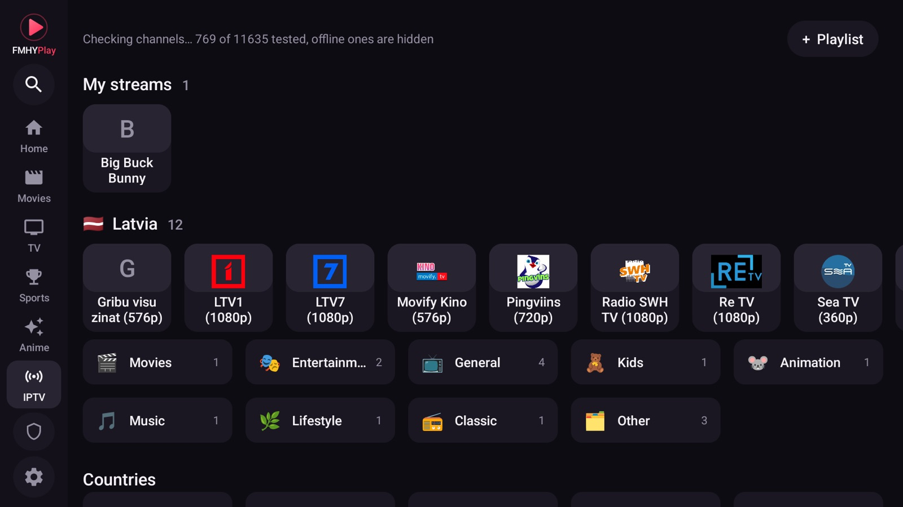
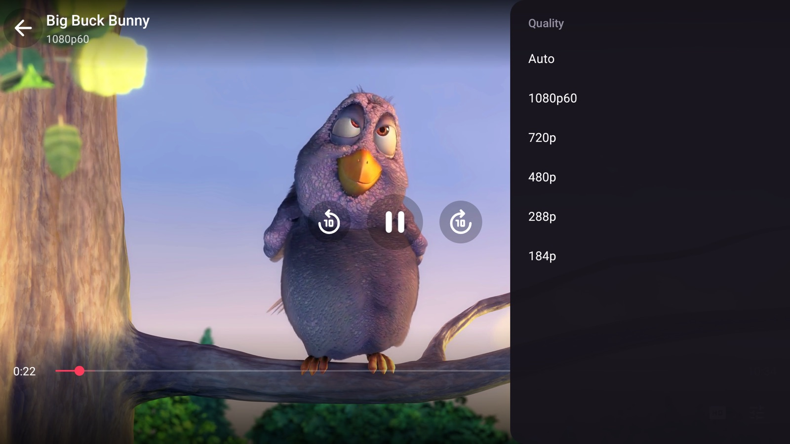
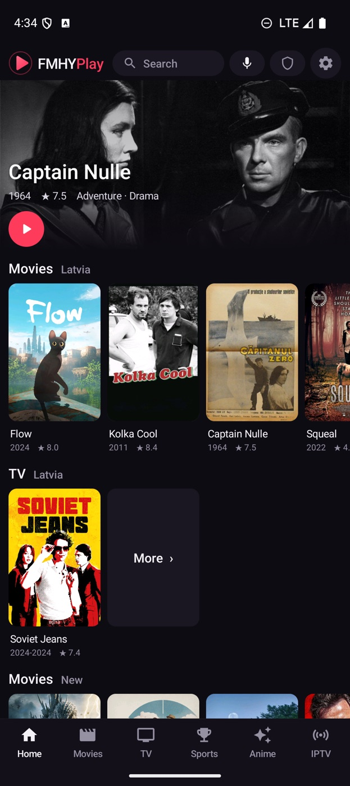
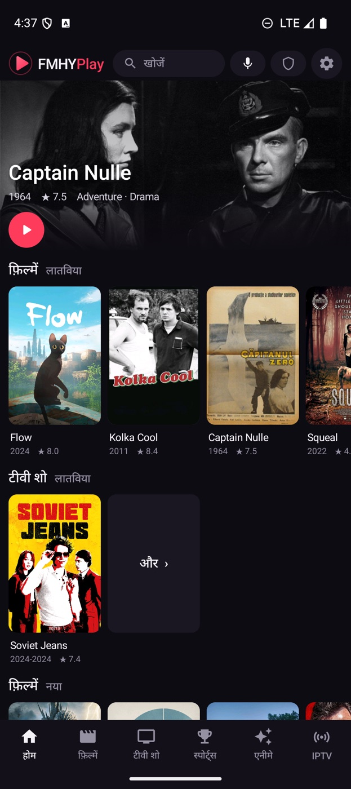
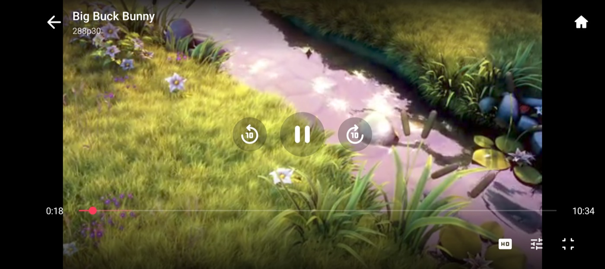
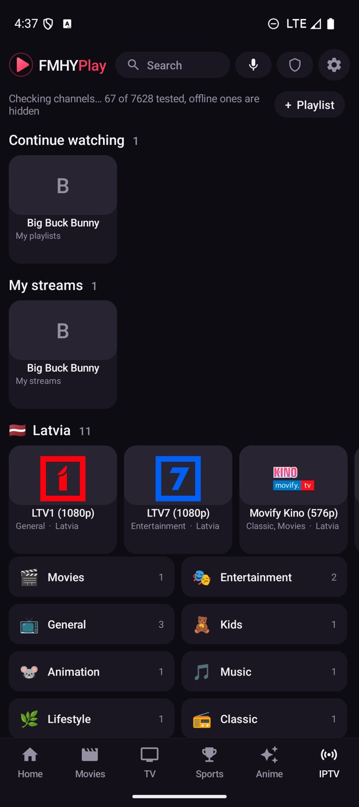

<p align="center">
  
</p>

<p align="center">
  <b>Any streaming site, a real player.</b><br>
  A TV-first Android app that opens the sites you choose, finds the video they play, and plays it in a native hardware-accelerated player.
</p>

<p align="center">
  <a href="https://github.com/fmhyplay/android/releases/latest"></a>
  <a href="https://github.com/fmhyplay/android/actions/workflows/build.yml"></a>
  
  
</p>

<p align="center">
  <a href="https://fmhyplay.github.io/android/">Documentation</a> ·
  <a href="https://github.com/fmhyplay/android/releases/latest">Download</a> ·
  <a href="https://fmhyplay.github.io/android/guide.html">User guide</a> ·
  <a href="https://fmhyplay.github.io/android/build.html">Build from source</a> ·
  <a href="https://buymeacoffee.com/rohit267">Support</a>
</p>

<p align="center">
  
</p>

## Why

Streaming sites are built for a desktop browser with a mouse. On a TV remote they are painful, they are full of pop-ups, and their embedded players stutter on weak hardware. FMHYPlay keeps the site (so you keep every title and server it offers) but takes over the part that goes wrong:

- It **finds the video stream** the page starts and plays it in **FMHYPlayer** (ExoPlayer with the hardware decoder), with nothing painted over the picture.
- It **drives the site for you**: pick a title and it opens that title's page (or the exact episode); the player's Episodes, Sub / Dub, Servers and Quality buttons press the site's own buttons, so you do not go back to the page.
- It **blocks ads and pop-ups**, **tunnels the app's own traffic** through Cloudflare WARP when you want it, and works with a **TV remote** and with **touch**.

## Features

**Cast to TV**
- The **Cast** button in the phone's player sends the video to a TV on the same Wi-Fi, from the same spot. The phone becomes the remote: play, pause, seek, ±10 s and TV volume (the phone's volume keys work too)
- **TV with FMHYPlay (recommended)**: the TV plays the stream itself, with the site's headers and cookie, WARP, ad blocking and subtitles. It opens even when FMHYPlay is closed on the TV
- **Chromecast, Google TV and TVs with Cast built in**: no app needed on the TV; the phone relays the stream so sites still accept it
- **DLNA / UPnP smart TVs** (Samsung, LG, Sony, Kodi and others): same relay; works best with MP4 and TS streams, since not every TV plays HLS

<p align="center"></p>

**Series and anime**
- **Episodes** strip in the player (stills and names along the bottom while the video plays), **Previous** and **Next**, and the next episode starts by itself
- **Skip intro, recap and credits** (times from TheIntroDB and AniSkip), with a Next episode button at the credits; *Settings, Skip intros* skips them for you
- **Sub / Dub** button for anime, remembered per site
- Opens the exact episode directly on 34 TV sites and 22 anime sites; elsewhere it presses the episode in the site's own list or menus

**FMHYPlayer**
- Hands off automatically when a page starts an HLS, DASH or live FLV stream; falls back to the page if the stream cannot be played
- Icon buttons in two groups: Previous, Next, Episodes on the left; Quality, Audio, Sub / Dub, Servers, Subtitles, More, Cast, Full screen on the right; menus open as a side panel; what is picked shows under the title, and on a TV the button the remote is on shows its name
- Replays the page's Referer, Origin and cookies, so streams that check them still play
- **Resumes where you stopped on any site or server**, with a Restart button; the place is saved every 10 seconds while you watch, and the subtitles you had on come back
- Quality list with frame rate (for example 1080p60), audio and subtitle tracks, speed and zoom modes
- **Servers and Quality buttons that control the site's own player**, including players inside cross-origin iframes
- **Volume boost** (up to +12 dB) and **Dialog boost** (clearer voices, off until you turn it on in Settings or in the player)
- **Debug overlay** (*More, Debug overlay*, off by default): a panel down the right edge with resolution, frame rate, codec and decoder (hardware or software), video and audio bitrate, network speed, buffer, frames shown and dropped, stream type, host, how long the video took to open, and memory, refreshed every second
- **Subtitles in any language** from OpenSubtitles, converted so every script shows right, remembered per title, optional auto subtitles in your language, and **auto-sync** that lines a file up with the speech; size, position, color, background and timing
- **Simkl** and **PunchPlay** tracking (optional): what you watch is tracked there, titles you finish are marked watched
- Phone: **picture in picture**, hold the right or left side for **2x**, follows the rotation lock with a Full screen button; swipe for brightness and volume, double-tap to skip 10 seconds
- **Back to Home in one step** from the player (phone: house button, TV: More, Home) and from a website (phone: a house at the top right, TV: Menu, Back to home), or by **holding Back for 3 seconds** on any screen
- A translucent **loading screen** (title, current step, a cat that spins while it works, jumps when the stream is found and stares when it gets stuck) while the app drives a site, until the player is up; tap it or press Back to see the page

**Browsing**
- Home with Continue watching, Favorites, **your country's movies and series first** (by language, from TMDB), then **New and Popular** for Movies, TV and Anime (from Cinemeta and Kitsu)
- A side rail on a TV, bottom tabs on a phone; pull down to refresh; trailers on title pages
- **One search** for movies, series, IPTV channels and sites, by typing or by voice
- A directory of streaming sites that tracks the [FMHY](https://github.com/fmhy/edit) lists; opens a title's own page on about 70 sites and searches the rest for you, then opens the match
- Anime opens on anime sites only
- **Add your own site**, an optional address bar, dark pages, a cursor for the TV remote (with funny and useful looks)
- Pop-ups that are real links open in the same tab (Back returns); pop-up ads are dropped, and "Join our Discord" style nag dialogs close by themselves

**Your language**
- English, Hindi, Spanish, Portuguese, Indonesian, Arabic (right to left) and German, picked from the phone's or TV's language

**Network and privacy**
- **In-app Cloudflare WARP**: a userspace WireGuard tunnel for the app's traffic only, with no VPN permission and no root; LAN addresses stay direct. A WARP log to share when it fails
- Domain-based ad, tracker and pop-up blocking, plus redirect blocking
- No FMHYPlay account, no analytics, no telemetry. Updates come from this repository's releases, looked for every hour and at every boot (even with the app closed), with What's new before you install

**IPTV**
- More than 11,000 public channels from [iptv-org](https://github.com/iptv-org/iptv), grouped by category and country, with logos
- A background check hides channels that are offline; your country's channels and its categories come first
- In the player: **Channel + / −**, Previous / Next and a **Channels strip** move through the channel's category
- **Add your own playlist, a single `.m3u8` stream link, an Xtream Codes login or a Stalker portal (MAC address)**; each playlist gets its own row
- **Category and Language filters** in every channel list, and **pins**: keep a list with its filters (India · News · Hindi) as its own row
- Favorite channels with a heart; channels also show up in the one search

**Engineering**
- Plain Java and SDK command-line tools, **no Gradle**, roughly 11 MB per APK
- Reproducible CI build and signed releases from a tag

## Screenshots

<table>
  <tr>
    <td></td>
    <td></td>
  </tr>
  <tr>
    <td></td>
    <td></td>
  </tr>
</table>

<p align="center">
  
  &nbsp;
  
  &nbsp;
  
</p>

<p align="center">
  
</p>

<p align="center">
  
</p>

## Install

Download the APK for your device from [Releases](https://github.com/fmhyplay/android/releases/latest):

| File | For |
| --- | --- |
| `FMHYPlay-TV-vX.Y.Z.apk` | Android TV, Google TV, Fire TV, boxes (adds the TV launcher entry) |
| `FMHYPlay-Android-vX.Y.Z.apk` | phones and tablets |

Allow installs from your file manager or browser, open the APK, done. On a TV, `adb install -r FMHYPlay-TV-vX.Y.Z.apk` works over the network. Updates install over the old version because releases are signed with the same key. Check a download with `SHA256SUMS.txt` from the release.

Requires Android 8.0 (API 26) or newer, arm64 or 32-bit ARM.

### Fire TV

1. On the Fire TV: *Settings → My Fire TV → About*, press OK on the device name 7 times (developer options on).
2. Install **Downloader** (by AFTVnews) from the Amazon Appstore.
3. *Settings → My Fire TV → Developer options → Install unknown apps* → turn on **Downloader**.
4. In Downloader, type the code **`9828006`** or `https://github.com/fmhyplay/android/releases/latest/download/FMHYPlay-TV.apk`, then *Go → Install → Open*.

Fire OS 7 or newer (Fire TV Stick 4K and later). The app updates itself afterwards. That link always gets the newest TV APK (`FMHYPlay-Android.apk` for phones).

## Build from source

```sh
git clone https://github.com/fmhyplay/android
cd android
warp/build.sh      # builds the WARP helper (needs Go and the Android NDK)
./build.sh         # needs an Android SDK (platform 34, build-tools) and JDK 17+
```

The APKs appear in the project folder. Details, signing and the CI setup are in the [build guide](https://fmhyplay.github.io/android/build.html).

## How it works

1. The page loads in a WebView. A small script (`assets/frame.js`) runs in every frame, including cross-origin embeds.
2. The WebView's requests are watched for HLS and DASH playlists; some sites hide them behind URLs without an extension, so downloads are also recognised by their first bytes.
3. When a stream shows up, the page is paused and the stream goes to ExoPlayer with the same headers and cookies the page used.
4. The same script reads the page's server and quality lists. The player's buttons send a click back to it, the page switches, and the new stream is handed over the same way.

## Support

FMHYPlay is free and made in spare time. If it is useful to you: [Buy me a coffee](https://buymeacoffee.com/rohit267) or [PayPal](https://paypal.me/champdev).

## Legal

FMHYPlay is a browser and a media player. It does not host, store, index or distribute any video, and it ships no list of streams. The sites it opens, the IPTV playlists it reads and the content they serve are provided by third parties; what you open and play is your responsibility, and you should only use content you have the right to watch. See [THIRD_PARTY.md](THIRD_PARTY.md) for the components and data sources it builds on. FMHYPlay is not affiliated with or endorsed by FMHY, Cloudflare, Stremio, OpenSubtitles, iptv-org or any streaming site.

## License

[MIT](LICENSE)
